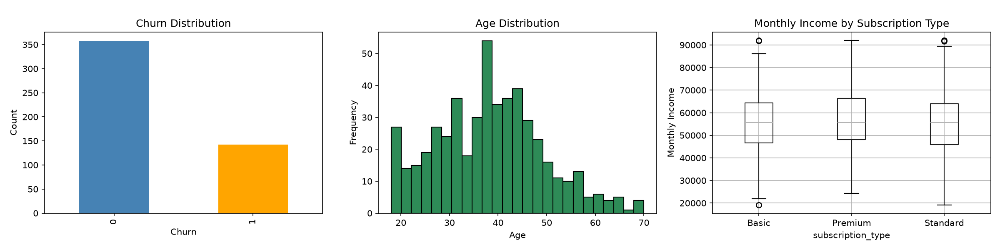

# Customer Churn Data Preprocessing

A complete data-preprocessing pipeline that prepares a raw customer churn dataset for machine learning.

The project performs data cleaning, missing-value handling, duplicate removal, outlier treatment, categorical encoding, numerical scaling, visualization, and final dataset export.

## Project Overview

The goal of this project is to transform a raw customer dataset into an ML-ready format.

The dataset contains customer information such as:

- Age
- Monthly income
- Tenure
- Number of products
- City
- Subscription type
- Churn label

The final processed dataset can be used directly for classification models such as Logistic Regression, Random Forest, XGBoost, or Neural Networks.

## Workflow

1. Generate/load the raw customer churn dataset  
2. Inspect missing values and dataset structure  
3. Remove duplicate records  
4. Handle missing numerical and categorical values  
5. Detect and cap outliers using the IQR method  
6. Create exploratory data visualizations  
7. Encode categorical variables using One-Hot Encoding  
8. Scale numerical variables using StandardScaler  
9. Export the final ML-ready dataset as CSV  

## Technologies Used

- Python
- Pandas
- NumPy
- Matplotlib
- scikit-learn

## Project Structure

```text
customer-churn-data-preprocessing/
│
├── data/
│   └── ml_ready_customer_churn.csv
│
├── notebooks/
│   └── customer_churn_preprocessing.ipynb
│
├── src/
│   └── customer_churn_preprocessing.py
│
├── images/
│   └── visualizations.png
│
├── .gitignore
├── README.md
├── requirements.txt
└── LICENSE
```

## Installation

Clone the repository:

```bash
git clone [https://github.com/](https://github.com/)<your-username>/customer-churn-data-preprocessing.git
cd customer-churn-data-preprocessing
```

Create and activate a virtual environment:

```bash
python -m venv venv

# Windows
venv\Scripts\activate

# macOS/Linux
source venv/bin/activate
```

Install dependencies:

```bash
pip install -r requirements.txt
```

## Usage

Run the preprocessing script:

```bash
python src/customer_churn_preprocessing.py
```

Or open the notebook:

```bash
jupyter notebook notebooks/customer_churn_preprocessing.ipynb
```

## Visualizations

The project includes the following visualizations:

1. Churn distribution  
2. Age distribution  
3. Monthly income by subscription type  



## Preprocessing Steps

| Step | Method |
|---|---|
| Missing values | Median imputation for numerical columns, mode imputation for categorical columns |
| Duplicates | Removed using `drop_duplicates()` |
| Outliers | Capped using the Interquartile Range (IQR) method |
| Categorical encoding | One-Hot Encoding |
| Numerical scaling | StandardScaler |
| Final output | `ml_ready_customer_churn.csv` |

## Output

The final dataset is saved as:

```text
data/ml_ready_customer_churn.csv
```

It contains scaled numerical features, encoded categorical features, and the target variable `churn`.

## Future Improvements

- Train and evaluate machine-learning classification models
- Perform feature importance analysis
- Add automated data-validation tests
- Deploy the preprocessing pipeline as an API
- Use a larger real-world customer dataset

## License

This project is licensed under the MIT License.